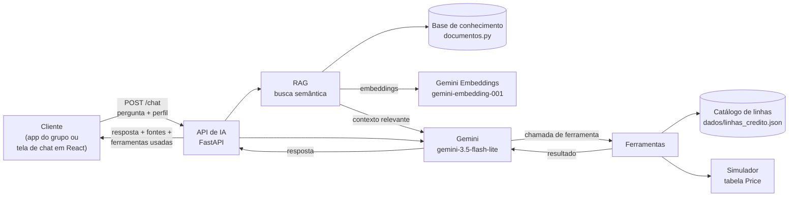

# AgroCrédito - API de IA

Global Solution 2026/2 - CitizenTech | FIAP | Análise e Desenvolvimento de Sistemas, 2º ano
Disciplina: Disruptive Architectures: IoT, IoB & Generative IA

## Integrantes

| Nome | RM |
|---|---|
| Aguinel Junior | RM564857 |
| Felipe Garcia | RM563485 |
| Henrique Gonçalves | RM562086 |
| Leonardo Saavedra | RM562229 |
| Vitor Mendes | RM565376 |

## O problema

Pequenos produtores rurais têm dificuldade para encontrar linhas de crédito, seguros e programas de incentivo, e para entender as condições de cada um. O AgroCrédito é uma plataforma que centraliza essas oportunidades e facilita o acesso à informação. Este repositório contém a **funcionalidade de inteligência artificial** da solução, avaliada na disciplina de Disruptive Architectures.

Cidadão beneficiado: agricultor familiar, de comunidade tradicional ou da reforma agrária, que precisa entender qual crédito rural combina com a sua realidade.

ODS relacionados: 2 (fome zero e agricultura sustentável), ao apoiar o acesso do pequeno produtor a crédito para produzir; 9 (indústria, inovação e infraestrutura), ao usar inteligência artificial para ampliar o acesso a serviços financeiros; e 10 (redução das desigualdades), ao tornar a informação sobre crédito acessível a agricultores familiares e comunidades tradicionais.

## A funcionalidade de IA

Um assistente conversacional que recebe a pergunta do produtor e o seu perfil cadastrado e:

1. Explica, em linguagem simples, como funcionam o Pronaf, o Plano Safra, os tipos de crédito, os documentos exigidos, o seguro rural e a renegociação de dívidas.
2. Indica as linhas de crédito compatíveis com o perfil (CAF ativo, categoria, finalidade e valor desejado).
3. Simula o financiamento (parcela mensal, total pago e juros) com uma ferramenta de cálculo, sem deixar o modelo fazer contas de cabeça.
4. Informa de quais documentos da base de conhecimento a resposta foi tirada.
5. Recusa assuntos fora do escopo e tentativas de burlar as regras.

A API é independente e pode ser consumida por qualquer cliente: o app do grupo (front e backend) ou a tela de chat de demonstração em React incluída neste repositório (`frontend/`). A funcionalidade de IA não depende do app do grupo para funcionar.

## Impacto e ecossistema

**Como o impacto será medido:**

- Qualidade das respostas: percentual de casos aprovados na avaliação automática (`avaliacao.py`) e percentual de respostas que citam fonte da base de conhecimento.
- Correção dos cálculos: simulações conferidas contra o valor calculado manualmente.
- Segurança: percentual de tentativas fora do escopo ou de burlar as regras que são recusadas corretamente.
- Benefício ao produtor: número de produtores atendidos e quantas consultas terminam com uma linha compatível indicada, indicadores que dependem do uso real pelo app.

**Quem participa do ecossistema:**

- Produtores: agricultores familiares, de comunidades tradicionais e da reforma agrária, que fazem as perguntas e recebem a orientação.
- Assistência técnica (ATER): ajuda o produtor com cadastro, projeto e documentos, e é indicada pelo assistente quando a base não tem a resposta.
- Bancos e cooperativas de crédito: decidem e contratam o crédito. O assistente apenas orienta e nunca aprova nem promete aprovação.
- Grupo de desenvolvimento: mantém a base de conhecimento e o catálogo de linhas atualizados a cada safra.

## Arquitetura



Fluxo de uma pergunta:

1. O cliente envia a pergunta e o perfil do produtor para `POST /chat`.
2. A API transforma a pergunta em embedding e compara com os embeddings dos documentos. Só os documentos com score igual ou acima do limiar entram no contexto.
3. O modelo recebe as regras, o contexto recuperado e as ferramentas disponíveis.
4. Se precisar de dados do perfil, das linhas compatíveis ou de um cálculo, o modelo chama uma ferramenta, e a API a executa e devolve o resultado.
5. A API devolve a resposta, as fontes usadas e as ferramentas chamadas.

## Modelos e tecnologias

| Tecnologia | Uso | Justificativa |
|---|---|---|
| Python e FastAPI | API REST | Validação de entrada com Pydantic e documentação automática em `/docs`, útil para testar e demonstrar. |
| Gemini `gemini-3.5-flash-lite` (API) | IA generativa | Modelo rápido e de baixo custo, adequado a um assistente de perguntas e respostas curtas. Usado por API, sem infraestrutura própria. |
| Gemini `gemini-embedding-001` (API) | Embeddings do RAG | Gera os vetores dos documentos e das perguntas. |
| NumPy | Similaridade | Produto escalar entre vetores normalizados (equivale à similaridade de cosseno). |
| Function Calling | Ferramentas | Permite que o modelo consulte o perfil, o catálogo e o simulador em vez de inventar dados e contas. |
| React e Vite | Tela de demonstração | Interface de chat que consome a API e mostra resposta, fontes e ferramentas usadas. |

### Aprofundamento escolhido: RAG

Escolhemos o **RAG básico** porque o domínio é de informação regulada que muda a cada safra (taxas, limites, programas). Em vez de depender do que o modelo "lembra", a resposta é construída a partir de documentos que a equipe controla e pode atualizar. Machine Learning e Visão Computacional não se aplicam ao problema, pois não há base de dados rotulada nem imagens.

Decisões de projeto:

- **Limiar mínimo de similaridade (`RAG_SCORE_MINIMO = 0.63`):** quando nenhum documento é relevante, o contexto vem vazio e o assistente admite que não tem a informação. O valor foi calibrado com os scores reais medidos (ver Avaliação).
- **Catálogo fora do código:** as linhas de crédito ficam em `dados/linhas_credito.json`, com fonte e vigência. Atualizar uma taxa ou limite é editar um arquivo.
- **Cálculos por ferramenta:** a simulação é feita em código determinístico, então o valor das parcelas não depende do modelo.

## Dados

- **Base de conhecimento (RAG):** 8 documentos em `api-ia/documentos.py`, escritos pela equipe como resumos de fontes oficiais do Plano Safra da Agricultura Familiar 2026/2027 e de programas de crédito rural. Não são o texto oficial.
- **Catálogo de linhas:** `api-ia/dados/linhas_credito.json`, baseado no resumo das linhas do Pronaf 2026/2027 do Ministério do Desenvolvimento Agrário (gov.br/mda), com vigência de 01/07/2026 a 30/06/2027.
- **Preparação:** os documentos são curtos e indexados inteiros (título e conteúdo). Os embeddings são gerados na primeira pergunta e mantidos em memória.
- **Dados do produtor:** vêm na requisição, e o contrato aceita apenas nome, CAF ativo, categoria, finalidade e valor desejado. A API não solicita nem armazena CPF ou documentos.

## Como executar

Requisitos: Python 3, uma chave da API do Gemini e, para a tela de demonstração, Node.js.

```
git clone https://github.com/Leonardo-Saavedra/AgroCredito-GS.git
cd AgroCredito-GS/api-ia
python -m venv .venv
.\.venv\Scripts\Activate.ps1
pip install -r requirements.txt
```

As versões das dependências estão fixadas em `requirements.txt`.

Configuração das credenciais: copie `.env.example` para `.env` e preencha a chave.

```
GEMINI_API_KEY=sua_chave_aqui
```

O arquivo `.env` está no `.gitignore` e nunca deve ser enviado ao repositório.

Subir a API:

```
uvicorn main:app --reload
```

A documentação interativa fica em `http://127.0.0.1:8000/docs`.

### Interface de demonstração (frontend)

Tela de chat em React (Vite) que consome a API. Requer Node.js. Com a API rodando, abra outro terminal, na raiz do repositório (pasta AgroCredito-GS), e execute:

```
cd frontend
npm install
npm run dev
```

Acesse `http://localhost:5173/`. A tela envia o perfil e a pergunta para `POST /chat` em `http://127.0.0.1:8000` e mostra a resposta, as fontes e as ferramentas usadas. A API libera CORS apenas para essa origem local.

## Contrato da API

`POST /chat`

Requisição:

```json
{
  "pergunta": "Quais linhas servem para comprar uma máquina pequena e quanto fica a parcela em 36 meses?",
  "perfil": {
    "nome": "Maria",
    "caf_ativo": true,
    "categoria": "agricultor_familiar",
    "finalidade": "maquinas",
    "valor_desejado": 50000
  },
  "conversaId": null
}
```

- `categoria`: `agricultor_familiar`, `reforma_agraria`, `indigena` ou `quilombola`.
- `finalidade` (opcional): `investimento`, `maquinas` ou `habitacao`.
- `conversaId` (opcional): identificador devolvido na resposta anterior, para continuar a conversa.

Resposta:

```json
{
  "resposta": "texto do assistente",
  "conversaId": "identificador da conversa",
  "fontes": [
    { "fonte": "guia-tipos-credito.md", "titulo": "Tipos de crédito rural", "score": 0.6667 }
  ],
  "ferramentasUsadas": ["buscar_perfil", "listar_linhas_compativeis", "simular_financiamento"]
}
```

Também existem `GET /` e `GET /saude` para verificar se a API está no ar. Entradas inválidas retornam 422, e falhas no modelo de IA retornam 502 com mensagem genérica.

## Avaliação

O script `api-ia/avaliacao.py` executa os casos de teste e gera o relatório `api-ia/docs/relatorio_avaliacao.md`.

```
cd api-ia
python avaliacao.py
```

Resultado da última execução: **28 de 28 casos aprovados**.

| Grupo | Casos | O que verifica |
|---|---|---|
| Ferramentas | 6 | Valor da simulação conferido manualmente, simulação sem juros, compatibilidade por CAF, categoria, finalidade e limite. |
| Situações de falha | 5 | Prazo zero, valor negativo, argumentos faltando, ferramenta não autorizada e perfil de outro produtor. |
| RAG | 12 | 8 perguntas com documento esperado e 4 perguntas fora do escopo que não devem recuperar documentos. |
| Chat completo | 5 | Uso da ferramenta de simulação, assunto fora do escopo, tentativa de revelar as instruções, promessa de aprovação e CPF informado pelo usuário. |

Métricas do RAG (8 perguntas válidas): o documento correto ficou em 1º lugar em 8 de 8 e entre os 3 primeiros em 8 de 8. O menor score de um documento esperado foi 0,6759 e o maior score de uma pergunta fora do escopo foi 0,5804. O limiar de 0,63 fica entre os dois grupos.

O valor da simulação foi conferido manualmente: R$ 50.000 a 1,5% ao ano em 36 meses resulta em parcela de R$ 1.421,02.

## Limitações

- O catálogo tem apenas 4 linhas do Pronaf. Linhas de custeio, comercialização e de outros programas não estão incluídas, e a compatibilidade usa regras simples (CAF, categoria e finalidade).
- As taxas e limites valem para a safra 2026/2027 e mudam a cada safra. A API informa a vigência, mas o catálogo precisa ser atualizado manualmente.
- A simulação usa a tabela Price, sem carência, seguros, tarifas ou bônus de adimplência. É uma estimativa, e as condições finais dependem da instituição financeira.
- A IA não aprova nem recusa crédito e não substitui o banco ou a assistência técnica.
- A base de conhecimento é pequena (8 documentos), então perguntas fora dela recebem a resposta de que a informação não está disponível.
- O limiar do RAG foi calibrado com poucos exemplos (8 válidos e 4 fora do escopo). Perguntas em linguagem muito diferente podem ficar abaixo do limiar, ou perguntas fora do escopo próximas ao tema podem passar.
- Os testes do chat completo dependem do comportamento do modelo, que não é totalmente determinístico, então o resultado pode variar entre execuções.
- Os embeddings ficam em memória e são recalculados quando a API reinicia.
- A API não tem autenticação nem armazenamento próprio: o perfil é enviado a cada requisição e é confiado como recebido. O histórico da conversa é mantido pelo serviço do Gemini por meio do `conversaId`.
- Nas conversas, a pergunta, o perfil e o contexto são enviados à API do Gemini, e por isso não devem conter dados pessoais sensíveis.
- O modelo pode acrescentar informações que não estão na base de conhecimento, mesmo com a instrução de usar apenas o contexto. Em um teste, ele indicou o sindicato rural como fonte de ajuda, o que não consta nos documentos. O RAG e o prompt reduzem esse risco, mas não o eliminam.
- Quando o valor desejado não está no perfil nem na pergunta, o modelo pode assumir um valor por conta própria. Em um teste, ele simulou o limite da linha (R$ 120 mil). Informar o valor no perfil evita isso.

## Uso responsável

- A chave da API fica no `.env`, fora do repositório (`.gitignore`), e apenas o `.env.example` é versionado.
- O contrato não tem campos de CPF ou documentos, e o assistente é instruído a não pedir nem repetir esses dados.
- O assistente é instruído a não prometer aprovação, a avisar que as simulações são estimativas, a citar a vigência das taxas e a recusar assuntos fora do escopo e pedidos para revelar ou alterar as suas regras (casos cobertos na avaliação).
- A entrada é validada (tamanho da pergunta e categorias permitidas) e os detalhes internos de erros ficam no log do servidor, sem aparecer para o usuário.

## Declaração de uso de IA generativa

O Claude (Anthropic) foi usado como ferramenta de apoio no desenvolvimento, para planejar a arquitetura, escrever e revisar trechos de código e redigir os documentos da base de conhecimento. O código foi revisado, testado e executado antes da entrega.

## Estrutura do repositório

```
AgroCredito-GS/
  README.md
  .gitignore
  frontend/
    src/App.jsx          tela de chat (React)
    src/index.css        estilo da tela
    package.json         dependências do front
  api-ia/
    main.py              rotas da API
    assistente.py        prompt, RAG e chamada de ferramentas
    rag.py               embeddings e busca por similaridade
    ferramentas.py       perfil, linhas compatíveis e simulador
    documentos.py        base de conhecimento
    schemas.py           contrato de entrada e saída
    config.py            modelos e parâmetros
    avaliacao.py         casos de teste e relatório
    dados/linhas_credito.json
    docs/relatorio_avaliacao.md
    requirements.txt
    .env.example
```